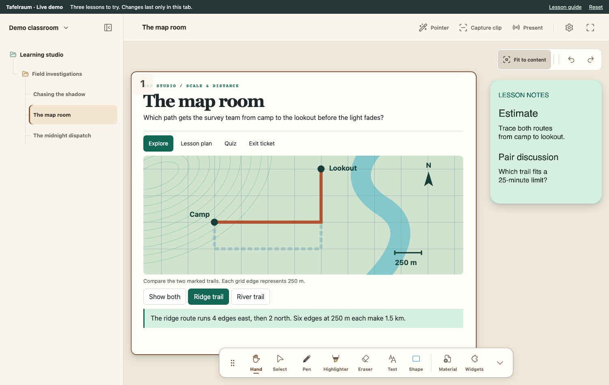
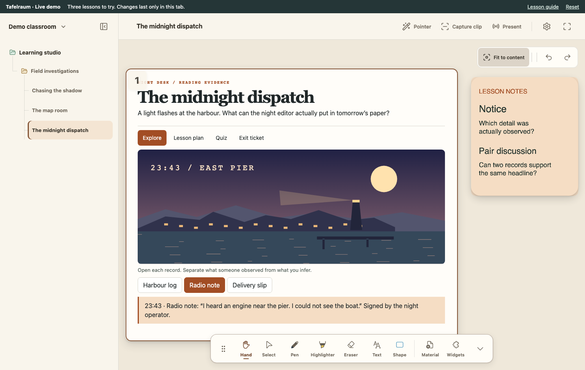
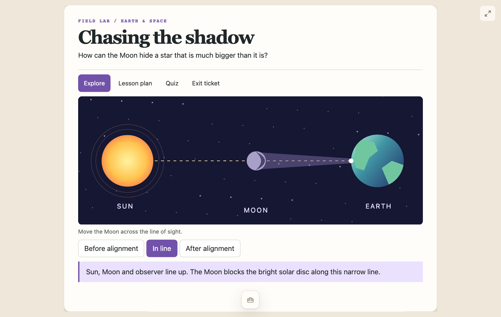

<p align="center"></p>

# Tafelraum

**An AI-powered local whiteboard for teaching.** Bring your own AI agent to turn a lesson idea into materials, arrange them on the board and prepare what the class will see. Then pick up the pen and teach on that same canvas.

**[Try the live demo](https://tafelraum-demo.jujies.app/guide.html)** · No installation or account needed. Open a lesson, try its HTML activity or send a numbered clip to Room Canvas. Reload to start fresh.



<details>
<summary>Explore the three demo lessons</summary>

- **[The map room](https://tafelraum-demo.jujies.app/?lesson=map-room)** — Trace a ridge trail and a river trail. Use the scale to decide which one fits a 25-minute hike.
- **[Chasing the shadow](https://tafelraum-demo.jujies.app/?lesson=eclipse)** — Move the Moon through three positions and predict which observer would see an eclipse.
- **[The midnight dispatch](https://tafelraum-demo.jujies.app/?lesson=dispatch)** — Cross-check a harbour log, a radio note and a delivery slip. Write a headline the evidence supports.



Each lesson includes a 45-minute plan, a two-question quiz with feedback and an exit ticket. On a phone, choose **Open just the activity** in the lesson guide.

</details>

## Features at a glance

### On the whiteboard

| Feature | What you can do |
| --- | --- |
| Drawing & annotation | Write with a pen, highlight, add text and shapes, zoom in on details and undo edits. Notes drawn on an image move with it. |
| Lesson materials | Arrange images and PDF pages beside audio, MP4 video, YouTube clips and web links. |
| Local lesson archive | Keep boards and original materials together by class, subject, unit and lesson. Copy a lesson for another group or restore it from the trash. |

### For teaching

| Feature | How I use it in class |
| --- | --- |
| AI-assisted preparation | Ask my own agent to create an activity, add it to the right lesson and lay it out on the board before class. |
| Room Canvas & numbered clips | Keep my overview on the laptop while the projector shows one task or diagram. Tap the next clip when the class is ready. |
| Reveal & annotate | Cover an answer while pairs discuss it, then uncover it. A student can write on the room display and keep their working in the lesson. |
| Interactive worksheets | Work through an HTML exercise or simulation from either window. Worksheets with a print layout can also become blank A4 handouts. |
| Media & timing | Control a video from my laptop while it plays on the classroom display, or place a countdown timer beside a group task. |
| Private lesson notes | Jot down who needs a follow-up next time. Student names and lesson notes stay out of the classroom display and canvas exports. |

<details>
<summary>Tools that need extra setup</summary>

With the local document converter configured, Tafelraum can import a Word document as a PDF and keep the original file. With your own capture relay, you can scan a QR code on a phone and send a photo straight to the current lesson.

</details>

## Why I built it

I liked the way I could organise my teaching materials in OneNote. What I wanted in class was a little different. I wanted to keep a worksheet, a picture and my next question together, write over them with a pen, and show just one of them on the board without rearranging my own view.

That became Tafelraum. I build it, try it in my own lessons and change things when they get in the way. After several months of using it that way, I wanted other teachers to be able to try it too. The name is German: *Tafel* is the classroom board, *Raum* is a room.

What made AI useful to me was being able to ask for something that would be *there when I opened the lesson*. A worksheet in a chat still leaves me with files to move and a board to set up. In Tafelraum, I can ask my agent to make the worksheet, put it in the right lesson and frame the first activity for the projector.

## What you can ask your AI agent to do

Here’s a follow-up I could ask for after teaching the map lesson above:

> In “The map room”, make a follow-up task for pairs: design a third route that is exactly 2.5 km long. Keep the map scale at 250 m per grid edge. Put the task beside the map and prepare a numbered clip so I can show it after we compare the first two trails.

The **agent you choose** supplies the AI. Tafelraum gives it tools to work with actual lessons and boards. With the teacher window open, you can ask it to:

- **Organise lessons.** Find a lesson by class, subject or unit, create one when needed and attach materials to the right lesson.
- **Make materials.** Draft a worksheet with answer fields, a quiz or an interactive HTML activity. The kit includes working examples, layout references and checks for the material format.
- **Prepare the board.** Place materials, text and shapes, arrange them together and set up numbered clips. Open the result, move anything by hand and choose when to show each clip.

**Connect your agent:** in Tafelraum, open **Settings → Connect agent → Copy starting prompt**. Paste it into an assistant that can read files and run tools on your computer. Ask it to identify the open lesson first, then give it a task like the one above. The whiteboard works without an AI account. If you use a cloud-backed assistant, its own data settings apply to what you share with it. [Agent setup and supported operations](docs/AGENT_WORKFLOW.md)

## A lesson in three moves

1. **Prepare.** Open a lesson and put a picture or PDF page on the canvas. Add a question beside it, or cover the answer until you need it.
2. **Choose what the class sees.** Make a numbered *clip* around a part of the board or assign one to a single item. Open **Present → Room Canvas** and move that window to the classroom display.
3. **Teach on the same board.** Switch clips as the lesson unfolds. You can annotate a diagram or let someone write on the room display. Their strokes become part of the same lesson.

<details>
<summary>See the classroom view</summary>



Room Canvas opens a second local window. You can try both windows on one screen before connecting a projector.

</details>

## Try it on your computer

This first public edition runs from source in a browser. You need Git and Node.js 22.18 or newer, with npm. Open a terminal and run:

```sh
git clone https://github.com/JUJIES/Tafelraum.git
cd Tafelraum/prototypes/surface-shell-a-b
npm ci
npm start
```

Open the local address printed in the terminal. Tafelraum creates an empty lesson archive on first launch. If the interface opens in German, choose **Einstellungen → Sprache → English**. For a first lesson, drop a picture onto the board and write a question next to it.

Press **Ctrl+C** in the terminal to stop. Run `npm start` in the same directory next time. Your lessons stay in `local-data/public-lessons/` inside the checkout. Copy that folder before deleting or moving the checkout.

<details>
<summary>How do I get updates?</summary>

Stop the local server. From an unmodified checkout, run `git pull --ff-only`, then `npm ci` and `npm start` in the app directory. This repository distributes source. There is no desktop installer or automatic binary update channel for this edition.

</details>

## Feedback and licence

If something gets in the way during a lesson, I’d like to hear what you were trying to do. [Open an issue](https://github.com/JUJIES/Tafelraum/issues) with a small example you can share publicly.

Tafelraum is **source available** under the [MIT License with Commons Clause 1.0](LICENSE). Third-party components keep their own [licences and notices](THIRD_PARTY_NOTICES.md).
