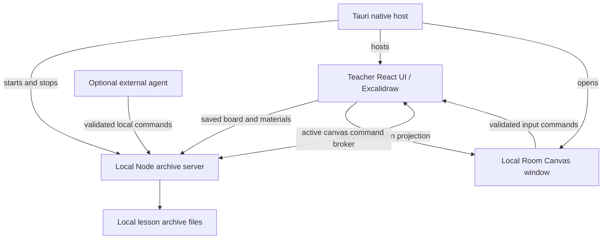

# Current public application architecture

This is the navigation map for the current implementation, not a future platform
design. Read [working states](WORKING_STATES.md) before changes and use a synthetic
archive. Historical concepts describe wider ambitions, including remote storage;
they do not make Beelink the public app's lesson store.

## Runtime and ownership

The browser source route runs the web UI and local server without the Tauri host.
The hosted demo is a separate constrained build with resettable examples, not an
online instance of the local archive service.

| Responsibility | Main entry points, relative to the repository |
| --- | --- |
| Navigation, settings and presentation controls | `prototypes/surface-shell-a-b/src/App.tsx` |
| Canvas adapter, gestures, material geometry and persistence integration | `prototypes/surface-shell-a-b/src/canvas/CanvasSurface.tsx`, `canvas-port.ts`, other modules in `src/canvas/` |
| Room projection, input commands, clips and media presentation | `prototypes/surface-shell-a-b/src/live/`, especially `room-canvas-host.ts` and `LiveViewerCanvas.tsx` |
| Static web runtime and local services | `prototypes/surface-shell-a-b/desktop-server.mjs`, `archive-server.mjs` |
| Native windows, menus, lifecycle and update installation | `prototypes/surface-shell-a-b/src-tauri/src/` |
| Agent command validation and broker | App `teaching-agent-protocol.mjs`, `canvas-agent-protocol.mjs`, `canvas-agent-server.mjs`; CLI tools in `scripts/` |
| Agent instructions and portable kit | `.agents/skills/`, `docs/AGENT_WORKFLOW.md`, `scripts/prepare-agent-kit.mjs` |
| Feature boundary and desktop delivery identity | App `distribution.json`, `distribution/desktop-channels.json`, `scripts/desktop-release-config.mjs` |

## Data and command flow

- **Canonical editing happens in the teacher scene.** Manual input and accepted
  agent/Room commands change the same scene. Do not save Room's reduced projection
  back as the lesson or create another persistence model for an agent.
- **The archive is the confirmed file store.** Catalogue, boards and assets use
  local server validation, serialised writes and revision checks. Browser
  caches/outboxes recover unconfirmed work; they are not a second confirmed
  archive. Recovery and native save-before-exit are described in
  [stability contract56 (German)](implementation/56_APP_STABILITY_AND_PERFORMANCE.md).
- **Materials enter the archive before use.** Source assets and rendered content
  follow existing imports; canvas geometry references those materials. Images/PDF
  pages use raster objects, while HTML/media use host projections over persistent
  geometry. See [material projection contract (German)](implementation/02_VERTRAG_INTERAKTIVE_MATERIALPROJEKTION.md).
- **Room is local presentation and bounded input.** It receives a safe projection
  over the local channel. Validated commands return to the teacher with generation
  and revision checks. Clips constrain the presentation camera, not access to
  confidential board content. See [Room input contract (German)](implementation/23_ROOM_CANVAS_INPUT_TEST.md).
- **Private notes have a separate boundary.** `student-notes-store.mjs` handles
  `_private/student-notes/`; these files do not enter Room or canvas inspection.
  Complete backups include them. File-authorised agents remain outside that
  interface boundary. See [data and privacy](DATA_AND_PRIVACY.md).
- **Agents use shared product operations.** Lesson selection, material installation
  and active-canvas commands are distinct steps. An active teacher session is
  needed for canvas operations. No model or personal plugin is required by the
  protocol; direct board-file editing is not the normal preparation route.

## Code layout and change boundaries

The historical `prototypes/surface-shell-a-b/` directory is the current teacher
app. `src/live/` contains shared presentation code; its name does not mean the
public edition enables the separate Remote Canvas service. Keep this distinction
when reading older implementation records.

Use [the script catalogue](../scripts/README.md) for commands and
[the browser-test guide](../scripts/BROWSER_TESTS.md) for synthetic checks. npm is
the documented app dependency workflow (`npm ci` and `package-lock.json`); Cargo
has its own native lockfile. The existing pnpm lockfile is not a second supported
setup instruction. Do not regenerate unrelated locks as part of a feature patch.

Keep common logic shared and deliberate edition/platform differences at their
adapters. The public checkout is independently editable; private history,
archives, keys and publisher tools are not public build prerequisites. See
[distribution boundary61 (German)](implementation/61_DISTRIBUTION_BOUNDARY.md).

Large components are candidates for focused extraction when responsibilities
are understood. Preserve gesture ordering, Room command validation, material
geometry and save/recovery semantics; splitting a file is not proof those
contracts still hold. A directory rename or canvas rewrite is not part of the
current Windows acceptance work.

## Desktop delivery and Windows status

Source profile and delivery channel are different. Source/self-built apps default
to manual updates. Official Public Mac and Windows packages use the public GitHub updater;
the full-edition colleagues channel is separate. Mac and Windows need separate
binaries; a public update manifest can select artifacts by platform.

Public0.1.92 provides Mac ARM64 and Windows x64 packages from the same frozen
source commit. Installed Windows, Room, save/restart and isolated updater
acceptance are recorded in [Windows QA](WINDOWS_QA.md). The [source checks](WINDOWS_SOURCE.md)
and [historical native plan](WINDOWS_NATIVE_PLAN.md) retain earlier findings;
they do not supersede that acceptance record. Clean-machine, physical stylus and
other untested hardware scenarios remain limits, not implied coverage.
Read [release workflow](RELEASE_WORKFLOW.md) and [channel contract65](implementation/65_DESKTOP_RELEASE_CHANNELS.md)
before build/delivery changes. Publishing is a separate authorised action.
