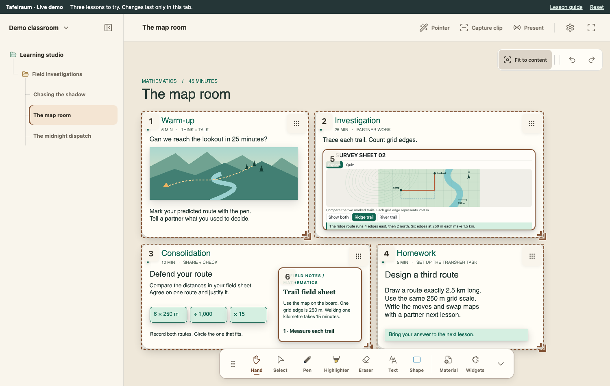
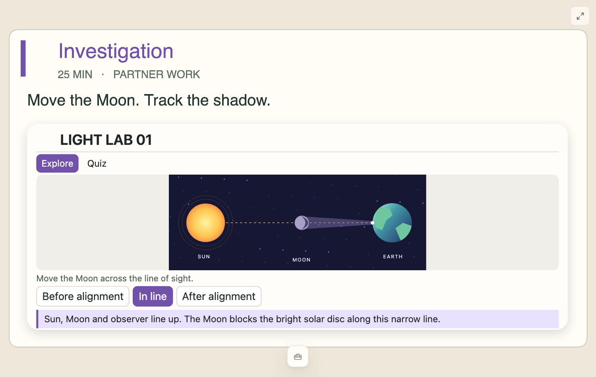

# Your first lesson

You can teach with Tafelraum without an AI assistant. Use a small picture or PDF
that you can share, and a question such as “What do you notice?”

## 1. Choose how to start

| Route | What you need | What happens to your work |
| --- | --- | --- |
| [Online demo](https://tafelraum-demo.jujies.app/?lesson=volcanoes) | A browser; no account or installation | Example lessons; reload restores the example. Your own imports and agent connections are unavailable. |
| [Public Mac app](https://updates.jujies.app/tafelraum-public/download/) | Apple Silicon Mac; follow the guide in the ZIP | Your archive is saved separately from the app. Official packages offer public updates. |
| [Run from source](../README.md#try-it-on-your-computer) | Git, Node.js and npm | Your archive lives in the checkout. `npm start` runs the browser app, not an installer. |

The Mac package is ad-hoc signed and **not Apple-notarized**. Read its included
guide before first opening it. A managed computer may require administrator help.
Native Windows packaging is still under local test; see
[Windows source setup and test limits](WINDOWS_SOURCE.md).

If controls appear in German, select **Einstellungen → Sprache → English**.
Lesson and material titles keep their original language.

## 2. Open or create a lesson

Expand the navigation on the left. A fresh local archive contains a starter
class, subject, unit and lesson; their initial names may be German. Open the
lesson. Rename it through its actions menu, or use **New lesson** under a unit
to create your own. If needed, create a class/course, subject and unit first.
The selected lesson is the destination for your materials and drawing.

In the online demo, select an existing example instead. Its navigation is a
demonstration, not your local archive.

## 3. Add material and a question

In the local app, drop a picture or PDF onto the canvas. Images and PDF pages
become material you can move and resize; PDF pages are displayed as images.
Use **Text** to add your question, then **Pen** or **Highlighter** to annotate it.
Use **Select** to move objects and **Fit to content** if you lose the overview.
Undo reverses an accidental edit.

*Demo example: navigation is on the left, presentation controls at the top, and
drawing tools below. Your new lesson starts with an empty canvas.*

## 4. Choose what the class sees

Select **Capture clip**, then drag a frame around the picture and question.
This creates a numbered view of that part of your board. A clip changes the
presentation view; it does not duplicate or remove your materials.

Open **Present → Room Canvas → Start**. Move the second window to your classroom
display, or place both windows side by side on one screen. Select your clip number
in the teacher window. Keep your overview in the teacher window while Room shows
the detail. Create another clip to try switching between two views.

*Room example from a different demo lesson: only the selected activity is shown.
An interactive worksheet is optional; your first clip can contain just a picture
and a question.*

Clips and answer covers are presentation tools, not a way to protect confidential
information. Keep private notes in the separate lesson-notes feature.

## 5. Finish and reopen

Stop presenting, wait for saving to complete and resolve any save warning before
closing. In the desktop app, quit normally. For the source edition, close the
teacher tab after saving, then stop the server with **Ctrl+C** in its terminal.
Next time, open the same app or run `npm start` in the same checkout and select
the lesson. Your saved picture, question and annotations should still be there.

The online demo deliberately resets when reloaded. The local app saves to files;
read [Data, privacy and backups](DATA_AND_PRIVACY.md) before moving or deleting an
installation or checkout. To have an assistant prepare your next lesson,
continue with [Connect an agent](AGENT_WORKFLOW.md).
