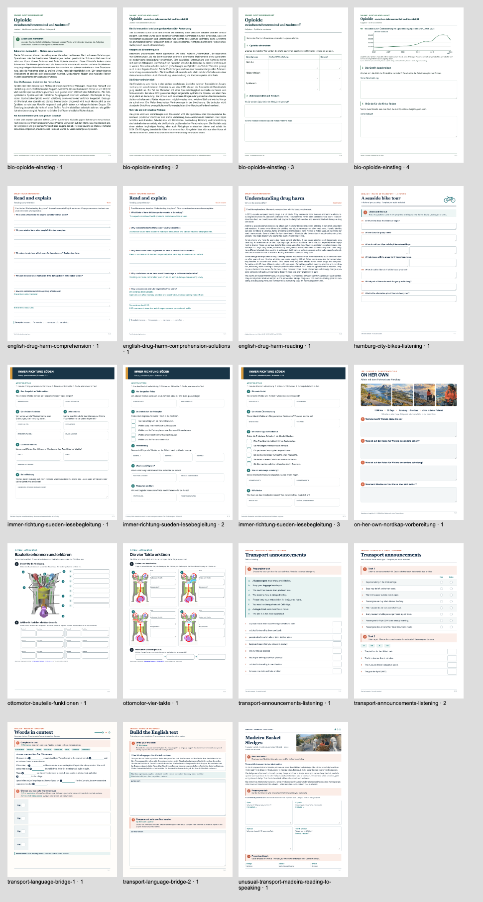

# Worksheet layout references

The local agent kit contains thirteen complete HTML packages drawn from nine teaching contexts. For a new worksheet, read the [layout guide](LAYOUT.md), choose two or three suitable references and view the actual pages. Create your own material in a writable folder with a new package ID.

| Reference | What to look for |
| --- | --- |
| [Transport announcements](transport-announcements-listening/pages.html) | Numbered tasks and two listening activities. The audio is separate. |
| [A seaside bike tour](hamburg-city-bikes-listening/pages.html) | One prominent assignment and short answer fields. Allow more room for longer explanations. |
| [Opioids](bio-opioide-einstieg/pages.html) | Reading and activity sections that can be handed out separately. Check the dates of historical statistics before teaching. |
| [Reading companion](immer-richtung-sueden-lesebegleitung/pages.html) | Shared reading followed by individual work. The book is required separately; no extracts are included. |
| [Engine parts](ottomotor-bauteile-funktionen/pages.html) and [four strokes](ottomotor-vier-takte/pages.html) | Label a diagram, then explain the process. Preserve the image licences. |
| [Drug harm reading](english-drug-harm-reading/pages.html), [questions](english-drug-harm-comprehension/pages.html) and [answers](english-drug-harm-comprehension-solutions/pages.html) | Separate reading, pupil tasks and answer key. The referenced external chart is not included. |
| [Madeira: reading to speaking](unusual-transport-madeira-reading-to-speaking/pages.html) | Image and text, selection of information and four planning fields for a short talk. |
| [Translation Bridge 1](transport-language-bridge-1/pages.html) and [2](transport-language-bridge-2/pages.html) | Sentence-length fields, visible working modes and separate draft and final answers. |
| [Film observation](on-her-own-nordkap-vorbereitung/pages.html) | A few open questions and generous writing space. The film is separate. |

Each package has a `manifest.json`; the screen and print entry is `pages.html` with `shared-pages`. These are layout references, not a complete curriculum. Review new content and print output independently.

From the repository or kit root, run `node scripts/check-interactive-material.mjs --source-dir docs/agent-references/PACKAGE --require-print`. The [two technical examples](../agent-examples/README.md) demonstrate the minimal integration. [Provenance and attribution](PROVENANCE.md) document asset rights. New reference files require review and explicit inclusion in `files.json`.
